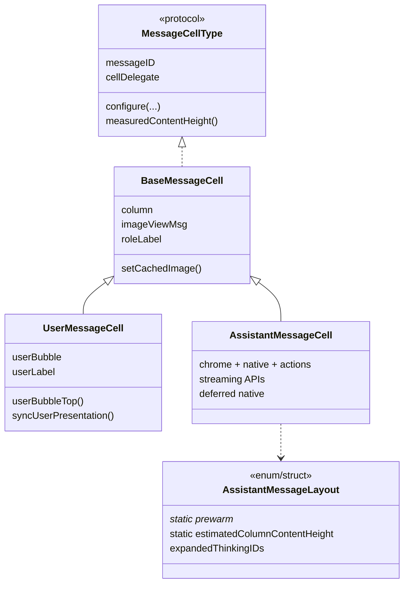

# MessageCell 拆分调研（User / Assistant）

> **状态：** 调研完成，待实施  
> **基线：** build 134（`638ce36`）  
> **目标设备：** iPad Air 1 / iOS 12.5.8  
> **问题：** 向上/向下滚动时，**每次**经过 user ↔ assistant 边界仍会卡顿；同一条 Q&A 第二次经过已较快（高度 pin 生效），但边界 hitch 不消失。

---

## 1. 结论摘要

| 维度 | 判断 |
|------|------|
| 是否值得拆 | **是**。现有「双 reuse ID + 单类」只分了池，没分视图树与 teardown 成本。 |
| 预期收益 | **边界 hitch 主因之一**（configure + prepareForReuse 的角色切换税）可显著下降；**不能单独消除**行高跃迁带来的 UITableView layout 成本。 |
| 数据层 | **不改** `ChatMessage[]`、1 message = 1 row。 |
| 推荐结构 | `BaseMessageCell` + `UserMessageCell` + `AssistantMessageCell` + 共享 metrics/delegate 协议。 |
|  dead code | ~720 行 WebKit / stable tiles **configure 路径已死**，应隔离或删除，降低 Assistant 类体积。 |

---

## 2. 问题与已排除方向

### 2.1 已确认现象（build 134）

- 内容渲染正确，底部 action 行完整。
- 同 Q&A 二次滚动快 → `measuredHeightIDs` + `contentHeights` 有效。
- **跨 Q&A 边界仍卡**，与是否首次渲染无关（内容已画好仍卡）。
- 滚动中 defer action 按钮（build 133）→ UX 变差、卡顿不变 → **action 行不是主因**。

### 2.2 已排除 / 暂缓方案

| 方案 | 结论 |
|------|------|
| Turn 合并单行（整轮 Q&A 一行） | 用户拒绝：改动面过大 |
| 批量 cheap height seeding | 导致底部吞行 |
| 滚动中隐藏 action | 无 perf 收益 |

---

## 3. 当前架构快照

### 3.1 文件与规模

| 文件 | 行数 | 职责 |
|------|------|------|
| `MessageCell.swift` | **2671** | 用户 + 助手 + WebKit 遗留 + 全部约束 |
| `ChatViewController.swift` | ~3000 | 唯一 `MessageCell` 消费者（15+ cast） |
| `NativeMessageRenderView.swift` | — | 助手正文 native 绘制 |

### 3.2 表格模型（不变）

```
messages[i]  →  row i
reuseID = user ? "UserMessageCell" : "AssistantMessageCell"
register(MessageCell.self, ...) × 2   ← 同类，不同池
```

### 3.3 活路径 vs 死路径

**configure() 活路径：**

```
shared preamble (image, theme)
├─ user  → bubble + early return (L609–641)
└─ assistant
     ├─ search / thinking chrome
     ├─ action row + version pager
     ├─ streaming / empty → assistantLabel
     └─ finished → configureNative() → NativeMessageRenderView
```

**configure() 从未调用：**

- `configureRichWeb()` (~490 行)
- `configureStableRich()` + stable tile stack (~230 行)
- `needsRichRenderer` 结果丢弃（L734–785）

Native 已是唯一 finished 正文路径；WebKit 仍占 ivar、`prepareForReuse` 注释逻辑、lazy `ensureWeb()`。

---

## 4. 视图与约束清单

### 4.1 仅 User

| 类型 | 成员 |
|------|------|
| Views | `userBubble`, `userLabel` |
| Constraints | `userTopToRole/Image`, `userBubbleBottom/Floor`, bubble 内 label insets |
| configure | ~32 行 + shared image preamble |
| 典型耗时 | **~0.1–0.5 ms**（无图）；+ 异步 decode |

### 4.2 仅 Assistant

| 类型 | 成员 |
|------|------|
| Chrome | `searchBox/*`, `thinkingBox/*` |
| Body | `assistantLabel`, `nativeRenderView`, `renderedReplyView`(dead) |
| Web | `webView`, `webSnapshotView`, web 约束组 (lazy, dead in configure) |
| Actions | `actionRow`, version pager, copy/retry/fork |
| Constraints | ~30 条互斥 top/bottom/height |
| configure | ~150 行 + `configureNative` |
| 典型耗时 | streaming **~0.5–2 ms**；cached native **~1–5 ms**；uncached **~5–50+ ms**（prewarm 缓解） |

### 4.3 共享

| 成员 | 说明 |
|------|------|
| `column`, `roleLabel`(恒 hidden), `imageViewMsg` | 两角色均可带图 |
| `columnWidthFill/Max`, `columnBottomPin`, `imageHeight` | 列宽与图片 |

**注意：** `searchTop` 锚在 `imageViewMsg.bottom`；user 行 search 恒 hidden，但视图仍在 hierarchy。

---

## 5. prepareForReuse 成本（拆分核心动机）

当前 **两种池共用同一 prepareForReuse**（L323–377），每次 reuse 都执行：

```
renderGeneration++
cancel height/width work
clear all labels
drain renderedReplyView (arrangedSubviews remove)
showActions(false)
setThinking(false)  → 约束切换
setSearch(false)    → 约束切换
hideNativeRender()  → nativeRenderView.clear()
hide user + assistant labels/bubble
image reset
~25 字段清零
（故意不 parkWeb — 防 flash）
```

### 5.1 User 池的浪费

User cell **从不**展示 thinking/search/native/web/actions，但每次 reuse 仍：

- `hideNativeRender()`（clear + 约束）
- `setThinking/setSearch(false)`（各 4–6 次 `isActive` 切换）
- `showActions(false)`
- `renderedReplyView` drain

### 5.2 边界场景（Q&A hitch）

向上滚：**assistant row 离屏** → assistant `prepareForReuse`（重）→ 稍后 **user row 入屏** → user `configure` 再次 hide 全套 assistant UI（冗余）。

向下滚：**user 离屏** → user `prepareForReuse`（仍清 assistant 状态）→ **assistant 入屏** → 完整 chrome + native configure。

**双 reuse ID 只保证「assistant 不会拿到刚用过的 user 实例」**，不保证 teardown/configure 轻量。

### 5.3 拆分后期望

| Cell | prepareForReuse |
|------|-----------------|
| `UserMessageCell` | 清 bubble/label/image/messageID；**无** native/chrome/action |
| `AssistantMessageCell` | 清 chrome/body/actions/native；**无** userBubble |

---

## 6. configure 分支对比

### 6.1 User path（L609–641）

每次执行（即使 cell 来自 user 池）：

```swift
hideStableRenderedReply()
hideNativeRender()
parkWeb()
setThinking(false); setSearch(false); showActions(false)
deactivate assistant* constraints; activate user* constraints
```

→ 在 monolith 里是**防御性**代码；独立 User 类后可删除整段。

### 6.2 Assistant path（L644–795）

1. Deactivate user constraints  
2. Search/thinking 状态机 + `populate*Body` + `setSearch/setThinking`  
3. `showActions` + `styleActionIcons`  
4. Guards：同 ID + defer + 已有 body → early return  
5. deferred native upgrade  
6. streaming → plain label；finished → `configureNative`

**configureNative**（L861–933）额外：10+ 约束切换、`nativeRenderView.configure`、height notify。

### 6.3 约束 churn 热点

| 函数 | 触发 |
|------|------|
| `setThinking(visible:expanded:)` | configure / toggle / prepareForReuse |
| `setSearch(visible:expanded:)` | 同上 |
| `setContentTops` | streaming plain |
| `configureNative` | native top 三选一 + bottom |
| `showActions` | pager 切换 copy leading 约束 |

User ↔ Assistant 边界 = **两套互斥约束图整页翻转**（即便视图已 hidden）。

---

## 7. ChatViewController 耦合面

### 7.1 注册与 dequeue

```swift
tableView.register(MessageCell.self, forCellReuseIdentifier: MessageCell.userReuseID)
tableView.register(MessageCell.self, forCellReuseIdentifier: MessageCell.assistantReuseID)
// cellForRow: as! MessageCell
```

拆分后：

```swift
register(UserMessageCell.self, ...)
register(AssistantMessageCell.self, ...)
// dequeue + configure 按 role
```

### 7.2 实例 API 使用矩阵

| API | User | Assistant | ChatVC 调用点 |
|-----|:----:|:---------:|---------------|
| `configure(with:preferredHeight:layoutWidth:)` | ✓ | ✓ | cellForRow |
| `setCachedImage` | ✓ | ✓(少见) | cellForRow |
| `syncUserPresentation` | ✓ | — | willDisplay |
| `ensureNativeLayoutWidth` | — | ✓ | willDisplay |
| `applyDeferredNativeRenderIfNeeded` | — | ✓ | willDisplay, scroll settle, prefetch |
| `hasPendingDeferredNativeRender` | — | ✓ | willDisplay, scroll |
| `measuredContentHeight` | ✓ | ✓ | willDisplay async pin |
| `updateStreamingContent` | — | ✓ | streamUITick |
| `transitionToFinishedPlainRendering` | — | ✓ | streamFinished |
| `userBubbleTop(in:)` | ✓ | — | jumpToUserQuestion |
| `syncSearchPresentation` / `finishChromeToggleLayout` | — | ✓ | thinking/search toggle |
| `refreshRenderDebugOverlay` | ✓ | ✓ | debug |
| `applyDeferredHeightIfNeeded` | — | ✓(web dead) | scroll settle |

### 7.3 静态 API（建议迁到 `AssistantMessageLayout`）

| 静态成员 | 用途 |
|----------|------|
| `actionRowReservedHeight` | 行高 slack |
| `hasCachedNativeLayout` | defer + prewarm |
| `prewarmLayouts` / `prewarmTurnWindow` | 滚动 prewarm |
| `estimatedColumnContentHeight` | estimatedHeightForRowAt |
| `isThinkingExpanded` / `expandedChromeMessageIDs` | 高度估算 / invalidate |
| `expandedThinkingIDs` / `expandedSearchIDs` | chrome 折叠态（全局） |

User 行 `cheapEstimatedHeight` 在 ChatVC 内，不依赖 MessageCell。

### 7.4 MessageCellDelegate

全部方法 typed to `MessageCell` → 改为 **`MessageCellType` 协议**（或 base class）：

- `messageCellShouldFreezeHeight`
- `messageCellShouldDeferHeavyRender`（仅 assistant）
- `didUpdateHeight` / `didFinishStableRender`
- copy / retry / fork / version shift

Assistant-only 回调可保留在 `AssistantMessageCellDelegate`，或统一协议用 default empty。

### 7.5 高度体系（拆分后不变）

```
measuredHeightIDs + contentHeights  →  fixed heightForRowAt
else automaticDimension + estimatedColumnContentHeight / cheapEstimatedHeight
streaming row → always automaticDimension
```

**边界 hitch 的第二来源：** user 行 (~80–120pt) 与 assistant 行 (~300–800pt) **高度差**导致 `contentSize` 重算；与 cell 拆分正交，但 estimated 准确可减轻。当前 `estimatedColumnContentHeight` 已较准；边界仍卡说明 **configure/teardown 仍是显著因子**。

---

## 8. 目标架构

### 8.1 类图



### 8.2 建议文件

| 文件 | 估行 | 内容 |
|------|------|------|
| `MessageCellDelegate.swift` | ~30 | 协议 + default impl |
| `MessageCellType.swift` | ~25 | 共有 instance API |
| `BaseMessageCell.swift` | ~120 | column/image/测量基础 |
| `UserMessageCell.swift` | ~250–350 | bubble configure + 轻量 reuse |
| `AssistantMessageCell.swift` | ~900–1100 | native/chrome/stream/actions |
| `AssistantMessageLayout.swift` | ~180 | 静态 prewarm/estimate/expanded IDs |
| `AssistantMessageCell+WebKit.swift` | ~720 | **可选**：`#if false` 或删除 |

`MessageCell.swift` → 删除或保留 typealias 过渡期。

### 8.3 BaseMessageCell 职责

- `setupColumn()`：column 宽度、bottom pin、imageView + height
- `configureImage(from:)`：shared preamble
- `measuredContentHeight()`：`column.bounds.height`
- `refreshRenderDebugOverlay()`：子类 override 画 border
- **不含** userBubble / nativeRenderView

### 8.4 UserMessageCell 职责

- `setupUserBubble()`
- `configure(with:...)`：仅 user 分支
- `prepareForReuse`：label/image/id 清零（**5–10 行级**）
- `syncUserPresentation`, `userBubbleTop`

### 8.5 AssistantMessageCell 职责

- 全部 chrome + native + action + streaming
- `prepareForReuse`：不清 userBubble（不存在）
- WK 遗留：Phase 1 **不编译进 target** 或 `#if CONNECTS_LEGACY_WEBKIT`

---

## 9. 边界 hitch 机制分解（假设验证）

| 因素 | 拆分能否缓解 | 验证方式 |
|------|-------------|----------|
| prepareForReuse 全量 teardown | **能** | Instruments: `prepareForReuse` self time ↓ on user pool |
| configure 角色切换 hide/show | **能** | User configure 无 hideNative/setThinking |
| 更浅 view hierarchy（user） | **能** | layoutSubviews count / depth |
| native configure on cached layout | 已快 | 二次仍边界卡 → 非主因 |
| 行高跃迁 + contentSize | **部分** | 对比 pin 前后 estimated error |
| `beginUpdates` from height delegate | 未知 | 边界是否触发 `didFinishStableRender` |

**测量计划（实施前后）：**

1. iPad Air 1：连续向上跨 5 个 turn，录屏 + 主观 hitch 计数。  
2. Instruments Time Profiler：过滤 `MessageCell.configure`, `prepareForReuse`, `layoutSubviews`。  
3. 对比 build 134 vs split：边界处 main thread 峰值 ms。

---

## 10. 风险与对策

| 风险 | 对策 |
|------|------|
| Delegate / cast 漏改 | 编译期：`MessageCellType` 协议 + 仅 ChatVC 一处 dequeue 工厂 |
| Streaming 最后一行 | 仍 `AssistantMessageCell`；API 不变 |
| Thinking/search 展开 | `expanded*IDs` 留静态共享；invalidate 逻辑不变 |
| User 带图 + assistant 带 transcription | 图像在 base；transcription chrome 仅 assistant |
| iOS 12 | 纯 UIKit 程序化布局，与现同 |
| 版本 pager | 留 assistant |
| `as? MessageCell` 15 处 | 改为 `as? MessageCellType` 或 role 分支 |

---

## 11. 分阶段实施

### Phase A — 骨架（低风险，可编译）

1. 提取 `MessageCellDelegate` + `MessageCellType` + `BaseMessageCell`（column/image）。  
2. `UserMessageCell` 从 monolith **复制** user 分支；ChatVC register/dequeue User。  
3. Assistant 仍用旧 `MessageCell` 或临时 subclass。**验证 user 行行为一致。**

### Phase B — Assistant 提取

1. `AssistantMessageCell` + `AssistantMessageLayout`。  
2. 迁移 streaming / deferred native / chrome toggles。  
3. ChatVC 全部改新类；删 monolith 中已迁代码。

### Phase C — 清理

1. 移除 / `#if false` WebKit + stable rich（~720 行）。  
2. 删 `MessageCell.swift` 或留 deprecated typealias。  
3. `pbxproj` 更新。  
4. build 135+，真机对比测试。

### Phase D — 若边界仍卡（后续）

- 行高：turn 级 estimated bucket（user 固定 band + assistant pinned）。  
- 不回到 turn-merge 单行方案。

---

## 12. ChatViewController 改动清单（实施时）

```
[ ] register UserMessageCell / AssistantMessageCell
[ ] cellForRow: factory by msg.role
[ ] visibleCells 迭代: MessageCellType 或 split cast
[ ] willDisplay: user → syncUserPresentation; assistant → native defer
[ ] MessageCellDelegate: parameter MessageCellType
[ ] 静态调用 MessageCell.* → AssistantMessageLayout.*
[ ] streamUITick / streamFinished: AssistantMessageCell only
[ ] jumpToUserQuestion: UserMessageCell.userBubbleTop
[ ] thinking/search notifications: unchanged row reload
```

---

## 13. 不在此次范围

- `messages[]` 结构、turn window prewarm 策略、viewport pinning  
- 重新启用 WebKit 渲染  
- Turn 合并单行  
- 滚动中 defer action（已证伪）

---

## 14. 决策点（实施前确认）

1. **WebKit 遗留：** 直接删除 vs `#if CONNECTS_LEGACY_WEBKIT` 归档？（建议 **归档不编进 target**）  
2. **Base vs 组合：** 建议 **BaseMessageCell 继承**（与现有 UITableViewCell 模式一致，iOS 12 友好）。  
3. **Phase A 是否先上设备：** 建议 **是**（仅 User 拆分即可验证 reuse 路径）。

---

*文档版本：2026-07-16 · 对应 build 134*
